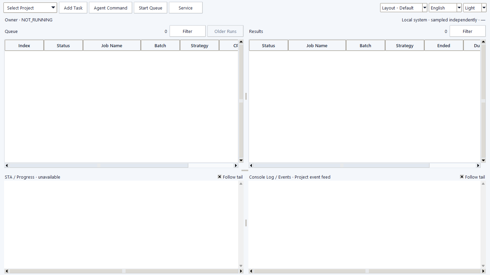

# AbqJobPilot · Public Research Preview

**Current development: 0.5.3 DEV** · Windows desktop · [Stable 0.2.2 installation](https://github.com/BrunelXian/AbqJobPilot/tree/main#installation) · [Evidence and qualification limits](docs/research-preview-evidence.md)

AbqJobPilot manages Abaqus jobs and records the evidence behind each result. An Abaqus user can open a Project, inspect its queue and review its run history in a Native Tk desktop application. A research client such as [VeriCAE Research Preview](https://github.com/BrunelXian/Goal-Driven-CAE-Orchestrator/tree/codex/vericae-0.5.5-public) can submit a bounded request and later reconnect to read the same Run and Receipt.



*The DEV workspace in Light mode, captured from a fresh local profile with no Project selected or Owner running.*

## Open the Windows GUI

Use 64-bit CPython 3.12 for Windows with Tcl/Tk. From PowerShell:

```powershell
git clone --branch dev/0.5.3 --single-branch https://github.com/BrunelXian/AbqJobPilot.git
cd AbqJobPilot
py -3.12-64 .\src\launch_gui.py --check
py -3.12-64 .\src\launch_gui.py
```

The first invocation checks the desktop runtime. The GUI and Project management work without an Abaqus installation. Use **Project** to create, open or switch to a recent Project. In **Settings → Abaqus Environments**, use **Auto Detect** or **Add Manually** to find a launcher, save a global default, or select a Project-specific environment. **Validate** checks the launcher's files and identity. Actual solver and license availability require separate verification.

## Follow a job from request to result

| Record or component | What it tells you |
| --- | --- |
| Project and Plan | The Project identifies the workspace and instance. The frozen Plan binds a job revision, inputs, resource limits, backend and digest. |
| Grant | A trusted operator approves specific actions against exact Plan digests and a finite budget with an expiry. Ordinary MCP clients can query Grant status. |
| Supervisor and Owner | The Supervisor hosts the authenticated local service. Its Owner controls admission, dispatch and the execution slot. A committed acceptance consumes one unit of delegated budget. |
| Run and Receipt | Look up the original acceptance Receipt by the submission's business key, then read its Run by ID. The Run records its Attempt, execution state and validation evidence. An acceptance Receipt can exist before execution finishes. |
| Results and verdicts | The INP/ODB paths can record input and output identity and SHA-256 provenance. Execution separates solver outcome, process containment and qualification. Extraction also reports result-data integrity; ODB reading requires its own scoped authorization. |

The live Agent-first MCP offers environment, Grant, submit, Run, Receipt and controlled extraction tools. Tool discovery alone cannot establish Owner availability or authorization. Its separate historical read-only profile exposes environment identity, Run status and Receipt lookup for eligible stored records.

## Try one TEST_ONLY job over real MCP stdio

This Windows integration test prepares a disposable Project and an exact one-use Fake Grant. A real MCP client connects over stdio, submits to a separate authenticated Owner process, disconnects after dispatch, and reconnects to check the original Receipt and result. Abaqus, a license server, a production Project and a Desktop MCP registration are unnecessary.

From the DEV checkout, prepare a private Python environment for the demo:

```powershell
py -3.12-64 -m venv .venv-preview
$python = (Resolve-Path .\.venv-preview\Scripts\python.exe).Path
& $python -m pip install -r .\src\requirements-mcp.txt "pytest>=8,<10"
```

In the same PowerShell session, run the named test using a fresh temporary output directory:

```powershell
$env:PYTHONPATH = (Resolve-Path .\src).Path
$env:PYTHONDONTWRITEBYTECODE = '1'
$env:PYTEST_DISABLE_PLUGIN_AUTOLOAD = '1'
$demo = Join-Path ([IO.Path]::GetTempPath()) ("abq-preview-" + [guid]::NewGuid().ToString("N"))
& $python -B -m pytest -q -p no:cacheprovider --basetemp="$demo" tests/test_delegated_fake_execution.py::test_same_run_stdio_submit_dispatch_result_and_reconnect
```

Expect `1 passed`. Inspect the proof that the test saved from the actual protocol replies:

```powershell
$proofFile = Get-ChildItem -LiteralPath $demo -Filter bridge-proof.json -File -Recurse
$proof = Get-Content -Raw -LiteralPath $proofFile.FullName | ConvertFrom-Json
$proof.events
$proof.terminal | Select-Object run_id, phase_attempt_id, execution, backend_outcome, solver_conclusion
$proof.terminal.fake_result_evidence | Select-Object verdict, digest, size
$proof.grant | Select-Object consumed, remaining
```

The Owner records `REQUEST_ACCEPTED → START_INTENT → FAKE_COMPLETED → VALIDATION_RECORDED`. The test compares the readback to the actual Fake JSON bytes, verifies that replay returns the same Receipt, and checks that a second key is rejected after the single unit is spent. Expected values include `FINISHED`, `solver_conclusion=NOT_RUN`, `consumed=1` and `remaining=0`.

## Qualification and roadmap

| Area | Current public claim |
| --- | --- |
| GUI-01 / INSTALL-01 | Project navigation and environment management passed manual acceptance. |
| INT-001 · historical real Abaqus evidence | Read-only MCP integration and the scientific cross-check succeeded. Overall **PARTIAL**. Execution and extraction qualification both remain **REVIEW_REQUIRED**. The historical extraction Receipt is **FAILED**, with result-data integrity **INSUFFICIENT**. |
| INT-002A.1 · delegated Fake execution | **TEST_ONLY PASS**. Engineering acceptance covered 250 targeted tests. The demo above exercises one same-Run path; real solver status is **NOT_RUN**. |
| INT-002B · new VeriCAE research task | Planning **PASS**. Execution **BLOCKED / STOPPED** with zero new submissions reported. The original Owner became unavailable and the current budget is unknown. |
| INSTALL-02 · general REAL execution | **NOT_READY**. The remaining work is to bind the selected environment to a new general-purpose solver Plan, recheck it at Owner dispatch and qualify that path end to end. |

The public tree contains selected source, tests and a sanitized evidence summary. Real HIL records, site configuration and private execution artifacts stay outside the preview. Future integration needs a separately authorized Owner handoff and independent validation of the resulting evidence.

[License](src/LICENSE)
