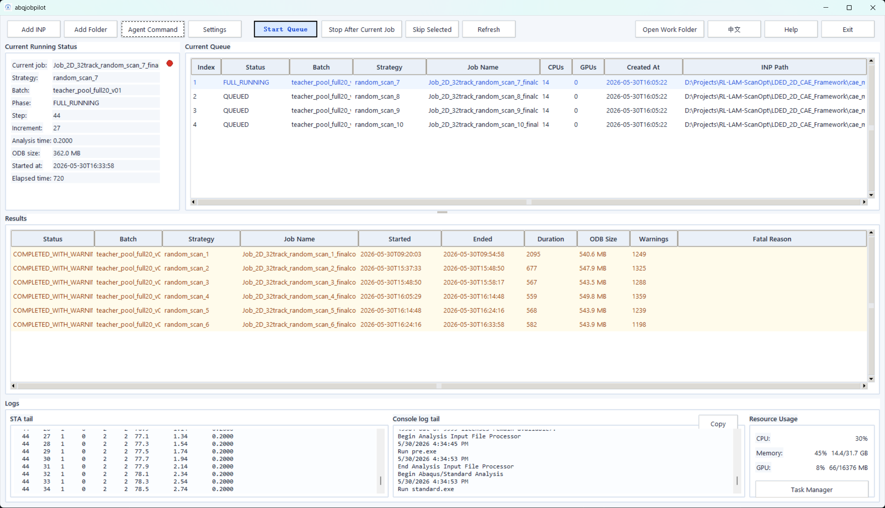

<div align="center">

# AbqJobPilot

**Abaqus 作业队列管理、Project 运行历史与 Agent-ready 工程执行工作台**

面向 Windows 的本地桌面工具：批量提交与监控 Abaqus `.inp`、保留执行证据，并向自动化脚本和 Agent 提供边界明确的接口。

[English](README.md) · **简体中文** · [开发分支 Develop](https://github.com/BrunelXian/AbqJobPilot/tree/Develop) · [稳定分支 main](https://github.com/BrunelXian/AbqJobPilot/tree/main)

[](#安装与环境)
[](#软件界面)
[](#安装与环境)
[](#核心工作流)
<br>
[](#agent-与-mcp开发版)
[](#版本与分支)
[](LICENSE)

</div>

## 项目概览

在 Abaqus 参数研究与批量计算中，工程师往往要反复打开命令窗口、手动提交 INP、查看求解日志，再将散落的 ODB、STA、MSG 等结果与计算记录对应起来。**AbqJobPilot** 将这套运行流程整合为一个本地工作台：顺序作业队列、实时状态与资源监控、Project 级历史记录，以及保守的进程追踪与中断处理。

它还提供 **Agent-ready** 接口：外部 AI 编程助手或脚本可以检查输入、准备作业、查询状态和定位输出；明确授权的队列接口可以入队。但是，**AbqJobPilot 并不是完整的自主 CAE Agent**，当前 MCP 服务也不能直接入队或启动 Abaqus。

本文介绍 **`Develop` 分支（`0.2.2.dev0`）**。稳定版 `main` 与开发版功能不完全相同，详情见[版本与分支](#版本与分支)。

## 软件界面

<div align="center">
  <a href="sample.png"></a>
</div>

*这是早期界面的存档截图，不代表当前 Develop 工作台。图中的示例作业数据也不是当前运行或验收结果；仍需补充新版截图。*

这套界面的核心是：**哪个作业正在运行、哪些作业还在等待、每次运行留下了什么证据？** 作业顺序、结果状态、STA/Console 日志尾部，以及本机资源信息都可在桌面工作流中查看。

## 功能亮点

| 领域 | Develop 当前能力 |
| --- | --- |
| **作业队列** | 添加单个 INP 或扫描文件夹；配置 CPU/GPU、可选 datacheck，在 GUI 中顺序执行。 |
| **实时监控** | 查看作业阶段、状态、STA/Console 尾部、CPU/内存/GPU 信息和结果路径。 |
| **安全控制** | 当前作业结束后停止队列；显式处理 Runner 所有权、输出冲突和不确定中断。 |
| **Project** | 各项目独立的 Queue、SQLite Job/Run 历史、报告与文件引用；不搬运工程文件。 |
| **执行证据** | 对 datacheck/full-run 原生采集部分进程身份，终态保存可用证据；最后一次真实 Abaqus 端到端验收仍待完成。 |
| **项目归档** | 以元数据为主的导入导出；只有显式选择时才包含 Project 内部自有文件。 |
| **Agent Command** | 带紧凑说明、多行输入及摘要式 Output 的内部命令工作台。 |
| **Automation / MCP** | Python API、JSON CLI 和可选的五工具只读/预览 MCP stdio 接口。 |

## 快速开始

若要使用最新开发功能，在 Windows PowerShell 中准备 Python 3.10+ 与 Tkinter：

```powershell
git clone --branch Develop https://github.com/BrunelXian/AbqJobPilot.git
cd AbqJobPilot
python -m venv .venv
.\.venv\Scripts\Activate.ps1
python -m pip install -r requirements.txt
python run_gui.py
```

启动 GUI 后，按照以下流程操作：

1. 在 **Settings** 配置本机已授权的 Abaqus 命令，确认 CPU/GPU 和 datacheck 参数。
2. 建议先创建或打开一个 **Project**；不必将 Abaqus 工程文件移动到 Project 目录。
3. 使用 **Add Task** 添加 INP 或扫描文件夹，检查 Queue 的待运行内容。
4. 点击 **Start Queue** 执行；**Stop After Current Job** 不会强杀当前求解器。
5. 在 **Results**、STA/Console、任务详情及 Project 历史中查看执行结果。

**入队不等于启动 Abaqus。** 真正求解需要已安装并获得授权的 Abaqus；公开 Agent API 不提供 Solver Start 命令。

## 安装与环境

| 条件 | 说明 |
| --- | --- |
| 操作系统 | Windows 桌面环境 |
| Python | 源码 GUI 为 3.10+；MCP 开发协议测试使用 Python 3.12.10 |
| GUI | Tkinter / ttk（在含对应组件的 Python 安装中属于标准库） |
| Abaqus | 真实求解需要单独安装并获得许可证 |
| 核心依赖 | 当前 `requirements.txt` 不声明额外第三方运行依赖 |
| MCP（可选） | `requirements-mcp.txt`，声明 `mcp>=2,<3`；开发测试使用 SDK 2.3.0 |

如果只使用稳定版 `main`，可以不加 `--branch Develop` 克隆，但应以该分支自己的版本和功能为准。以上为**源码运行**，不代表仓库已提供可下载的 Windows 独立安装包。Abaqus 命令路径应在 Settings 配置，避免提交个人电脑路径到公共仓库。

## 核心工作流

```text
A · 工程师控制的批量求解
Project → 添加/检查 INP → Queue → GUI Start Queue
                                     ├─ Datacheck（可选）
                                     └─ Full Run
                   → STA/MSG/DAT/LOG/ODB → Results + Run History

B · 脚本与 Agent 准备作业
外部脚本 / Agent → JSON CLI 或 Python API
                  → Preflight / Dry-run / 显式 queue-only 入队
                  → 由工程师在 GUI 中启动队列

C · MCP 辅助查询（Develop）
MCP 客户端 → 绑定单个 Project 的 stdio 服务
           → 检查 / 列表 / 状态 / 输出路径 / Dry-run 准备
           → 不提供真实入队和 Solver Start 工具
```

**执行权限仍属于本地 GUI Runner。** Python/JSON CLI 的 `--enqueue-only` 能写入队列元数据；MCP 的 `abq_prepare_enqueue` 更保守，只做 Dry-run，**绝不会写入队列**。

## Project 模型与数据所有权

**Project 拥有自己的运行数据；原工程目录继续拥有 Abaqus 文件。** AbqJobPilot 只负责发现、打开和操作 Project。软件级最近项目列表主要保存导航信息，不保存唯一的运行历史；大型 ODB/CAE 文件不会被塞进数据库。

```text
Abaqus 工程目录                         AbqJobPilot Project
D:\Engineering\Study01\                ~\.abqjobpilot\projects\Study01\
  model.cae                                project.json
  model.inp                                project.db （按需生成的 SQLite 历史）
  model.odb                                runtime\queue.json
  model.sta                                runtime\live_status.json
  model.msg                                runtime\reports\
  model.dat                                  process_evidence\<queue_id>.json
  model.log
```

新 Project 默认位于源码仓库之外的 **`~/.abqjobpilot/projects/`**，并可在 **Basic Settings** 中修改默认父目录。旧 Project 不自动迁移，工程文件路径仍指向原位置。导入导出只在明确选定范围内复制 Project 自有数据。

无正式 Project 模式下，新安装使用 `~/.abqjobpilot/installations/` 中按安装实例隔离的 runtime。旧安装如果已经在软件目录的 `runtime/` 中保存了作业或报告，会继续沿用，避免把旧作业静默隐藏。**稳定版与开发版不要同时操作同一个活动 Project/Queue。**

SQLite 记录的是 Job、Run、Artifact 的**元数据和路径**，不是 ODB 文件本体。整体复制 Project 目录并不会自动迁移外部引用的 INP/ODB；工程目录搬家后可能需要重新定位。

Project 导出默认选择 **Metadata Archive（元数据归档）**；只有显式选择 **Archive with Project-Owned Files（包含 Project 自有文件）** 时，才额外收集 Project 目录内部的文件。两种模式都不会静默打包外部引用的工程文件。旧 runtime 导入以元数据为主，原始文件保持不变。历史日志路径上的文件也可能已被后续尝试覆盖，并非不可变快照。

参见 [Project 数据归属](docs/ABQJOBPILOT_PROJECT_MODEL.md) 和 [Project 数据库](docs/ABQJOBPILOT_PROJECT_DATABASE.md)。

## Agent 与 MCP（开发版）

AbqJobPilot 有 **三种不同接口**，不能混为一谈：

| 接口 | 面向对象 | 能力边界 |
| --- | --- | --- |
| **Agent Command Console** | 在 GUI 中粘贴 AI 命令的工程师 | Project 选择、查询、queue-only 入队；不是系统 Shell。 |
| **Python API / JSON CLI** | 自动化脚本和代码 Agent | Project 管理、Preflight、Dry-run、显式入队、状态、结果、历史。 |
| **MCP Server（stdio）** | 兼容 MCP 的客户端 | 启动时绑定一个正式 Project；五个只读/预览工具，**不可入队**。 |

### Agent Command Console

GUI Console 包含紧凑的 AI Instruction、多行命令输入、摘要优先的 Output，以及展开/复制原始结果的能力。例如：

```text
project list
project use --project "Example Study"
enqueue --inp "D:\Engineering\Study01\model.inp" --cpus 4 --gpus 0
list
status --job-id "QUEUE_ID"
outputs --job-id "QUEUE_ID"
```

它不能执行任意 CMD/PowerShell。`project use` 修改的是 **Console 的目标 Project**，不是 GUI 主界面当前 Project。执行 `enqueue` 仅表示写入队列，**不是 Abaqus 已经开始计算**。

### Python API / JSON CLI

```powershell
python -m abqjobpilot.api.cli capabilities --json
python -m abqjobpilot.api.cli project create --name "Example Study" --path "C:\CAE\ExampleManager" --json
python -m abqjobpilot.api.cli project list --json
python -m abqjobpilot.api.cli preflight --project "C:\CAE\ExampleManager" --inp "D:\Engineering\Study01\model.inp" --cpus 4 --json
python -m abqjobpilot.api.cli enqueue --project "C:\CAE\ExampleManager" --inp "D:\Engineering\Study01\model.inp" --dry-run --json
python -m abqjobpilot.api.cli status --project "C:\CAE\ExampleManager" --job-id "QUEUE_ID" --json
python -m abqjobpilot.api.cli locate-outputs --project "C:\CAE\ExampleManager" --job-id "QUEUE_ID" --json
```

`project create` 示例要求目标目录尚不存在；`QUEUE_ID` 是真实队列记录返回的标识占位符。正式入队使用 `--enqueue-only`，并明确指定 `--project` 或 `--project-id`。它只写队列元数据；若 GUI Runner 已在运行，新任务可能随后被其领取。不提供 Project 选择器时，CLI 保留旧版默认 runtime 行为，而非自动选择最近 Project。公开 CLI 不提供直接启动求解器的命令。详见 [Python / JSON API](docs/ABQJOBPILOT_PUBLIC_API.md)、[Project Automation](docs/ABQJOBPILOT_A4_PROJECT_AUTOMATION.md)。

### MCP 安装与连接

MCP 是**可选的开发版功能**。在激活的 `Develop` Python 环境中执行：

```powershell
python -m pip install -r requirements-mcp.txt
python -m abqjobpilot.mcp.server --help
```

真正的服务启动命令如下。它等待 MCP 客户端通过 stdio 连接，不会启动 Abaqus：

```powershell
python -m abqjobpilot.mcp.server --project "C:\CAE\ExampleManager"
```

让 MCP 客户端使用 stdio 启动服务。以下是通用配置样例，实际路径需替换：

```json
{
  "mcpServers": {
    "abqjobpilot-readonly": {
      "command": "C:\\path\\to\\AbqJobPilot\\.venv\\Scripts\\python.exe",
      "args": ["-m", "abqjobpilot.mcp.server", "--project", "C:\\CAE\\ExampleManager"],
      "cwd": "C:\\path\\to\\AbqJobPilot"
    }
  }
}
```

Project 必须已经存在并包含 `project.json`。不同客户端的配置字段不完全一样，上面的 JSON **不是某个具体厂商客户端已通过端到端验收的声明**。所用 Python 需要安装官方 MCP SDK v2；若要访问另一个 Project，需要启动另一个绑定该 Project 的 Server。

| MCP 工具 | 主要输入 | 实际提供的能力 |
| --- | --- | --- |
| `abq_preflight` | `inp_path`；可选 `job_name`、`cpus`、`gpus`、`working_dir`、`batch`、`strategy` | 检查/预览 INP 请求；**不是**真正的 Abaqus datacheck。 |
| `abq_list_jobs` | `scope=queue\|history`；可选筛选条件与 `limit` | 查询 Queue 或 Project Job 历史；默认 50 条，上限 100 条。 |
| `abq_job_status` | `scope`、`identifier` | 查询保存的状态；历史 RUNNING 不等于已确认进程仍在运行。 |
| `abq_locate_outputs` | `queue_id` 或 `inp_path`，二选一 | 查找记录/预期的结果路径；文件存在不代表 ODB 有效。 |
| `abq_prepare_enqueue` | 与 `abq_preflight` 相同 | **仅 Dry-run**，不修改 Queue，不启动 Runner/Solver。 |

现有 MCP 测试覆盖官方 SDK 下的 stdio 初始化、工具枚举、调用和参数错误；不能据此推断所有第三方客户端均已完成验收。参数、返回结构和故障排查详见 [MCP 开发文档](docs/ABQJOBPILOT_MCP.md)。

## 执行证据与安全边界

AbqJobPilot 的设计要求区分：**用户请求了什么、系统记录了什么、哪些行为获得真实证据验证。**

- 真正的 Abaqus 执行由 GUI Runner 管理；公开 Agent 接口不直接启动 Solver。
- Datacheck 与 Full-run 分阶段记录运行过程与可用的原生进程证据。
- 进程身份尽可能使用 Windows **PID + 创建时间**，防止 PID 重用导致错误关联；父子关系必须有证据。
- 执行证据可保存在 `runtime/reports/process_evidence/<queue_id>.json`，并由 Project 历史引用。
- 短生命周期或脱离启动器的进程仍可能漏采；**UNKNOWN 不得当作 VERIFIED**。
- `.lck`、启动器返回码为零、存在 `.odb` 均不能单独证明 Abaqus 求解物理有效。
- **Stop After Current Job** 不强制终止当前 Solver；中断与不确定状态不能无证据自动重试。
- Runtime JSON、报告和 SQLite **不构成跨文件原子事务**，可检测的投影失败需要保留诊断信息。

**验证说明：** 新原生进程追踪和持久化实现已通过模拟回归，但在该开发版本记录时仍**缺少最后一次真实 Abaqus 端到端验收**。更多内容参见 [进程身份](docs/ABQJOBPILOT_PROCESS_IDENTITY.md)、[Runtime 协调](docs/ABQJOBPILOT_RUNTIME_COORDINATION.md)、[恢复机制](docs/ABQJOBPILOT_RECOVERY_AND_RECONCILIATION.md)。

## 版本与分支

| 通道 | 分支 | 定位 |
| --- | --- | --- |
| 稳定版源码 | [`main`](https://github.com/BrunelXian/AbqJobPilot/tree/main) | 已发布的稳定代码线，需按其自身版本判断功能。 |
| 开发版源码 | [`Develop`](https://github.com/BrunelXian/AbqJobPilot/tree/Develop) | 本文所述 **`0.2.2.dev0`**，含 Project、Agent/MCP 和过程证据等开发功能。 |

先前检查的远端 `main` 源码版本为 `0.1.0`；本机另外安装的稳定程序可以有不同版本。不要把本地稳定程序版本等同于 GitHub `main` 的当前版本。本文说明的是源码开发分支，不宣称存在对应的独立安装包。

## 仓库结构

```text
AbqJobPilot/
├── abqjobpilot/
│   ├── gui_app.py             主 GUI 与控制逻辑
│   ├── command_console.py     Agent Command Console
│   ├── runner_core.py         Abaqus 顺序 Runner
│   ├── process_identity.py    进程身份核验
│   ├── run_evidence.py        原生进程证据
│   ├── queue_store.py         Queue 状态存储
│   ├── project/               Project 元数据与归档
│   ├── database/              Project 历史数据库
│   ├── api/                   Python API 与 JSON CLI
│   └── mcp/                   可选 MCP stdio 接口
├── docs/                      架构与使用文档
├── tests/                     单元测试与模拟回归
├── requirements.txt           核心依赖
├── requirements-mcp.txt       可选 MCP 依赖
├── run_gui.py                 GUI 源码启动入口
├── sample.png                 界面截图
├── README.md / README_CN.md
└── LICENSE
```

## 文档导航

| 文档 | 内容 |
| --- | --- |
| [Python / JSON API](docs/ABQJOBPILOT_PUBLIC_API.md) | 自动化命令与返回契约 |
| [MCP](docs/ABQJOBPILOT_MCP.md) | Stdio 接入、五个工具与安全边界 |
| [Project 模型](docs/ABQJOBPILOT_PROJECT_MODEL.md) | 数据归属、目录结构、导入导出 |
| [Project 数据库](docs/ABQJOBPILOT_PROJECT_DATABASE.md) | Job/Run 与 Artifact 历史 |
| [Project 自动化](docs/ABQJOBPILOT_A4_PROJECT_AUTOMATION.md) | Project 级 CLI/API 操作 |
| [进程身份](docs/ABQJOBPILOT_PROCESS_IDENTITY.md) | PID、父子关系及局限 |
| [Runtime 协调](docs/ABQJOBPILOT_RUNTIME_COORDINATION.md) | 锁与 Runner 所有权 |
| [故障恢复](docs/ABQJOBPILOT_RECOVERY_AND_RECONCILIATION.md) | 中断状态、证据与非自动恢复 |

## 验证与测试

在已安装 pytest 的开发环境中执行：

```powershell
python -m pytest -q
python -m compileall abqjobpilot
```

非 Solver 测试覆盖 GUI、旧 Project 兼容、WARNING 解析、模拟进程证据、CLI 和 MCP stdio 协议。**Mock 测试或 skipped 不等于真实 Abaqus 进程链验收。** 部分 Tk 测试需要正常的交互式 Windows 桌面；真实 Solver 测试应在获得授权后使用独立 Project 和一次性 INP。

## 已知限制

- 以 Windows 本地工作站为目标，不是分布式 HPC 作业调度器。
- 公开 Agent 接口不提供系统 Shell 或 Solver Start 能力。
- MCP 仅绑定单个 Project 的 stdio 服务，目前为五个只读/预览工具，而非完整自主工程 Agent。
- Project 历史引用外部文件路径；工程文件位置变化后可能需要修复引用。
- 短暂进程可能漏采，物理结果仍需工程验证。
- 稳定版和开发版不要同时操作一个活动 Project/Queue。
- 本文不声称 Windows Installer 或具体第三方 MCP 客户端已经完成公开发布与验收。

## 后续计划

以下为研发方向，并非承诺的发布日期：

- 对原生进程证据与 Project 重开执行最后一次真实 Abaqus 端到端验收。
- 完善 Runtime JSON、报告与 SQLite 投影不一致时的对账机制。
- 增加显式 Project 迁移与外部工程路径修复能力。
- Windows 独立打包和干净机器部署验证。
- 提升 Agent 对工程执行过程的可观测性，**不绕过人类授权的执行边界**。

## 维护者与贡献

<div align="center">
  <a href="https://github.com/BrunelXian">
    
    <br>
    <sub><b>@BrunelXian</b></sub>
  </a>
  <br>
  项目维护者
</div>

欢迎提交可复现的问题报告与改进建议。公开 Issue 中请勿附带个人 Project 数据库、专有 Abaqus 模型及真实求解结果。

## 许可证

AbqJobPilot 使用 [MIT License](LICENSE)。Abaqus 是独立的商业软件，使用 AbqJobPilot 并不附带 Abaqus 授权。
