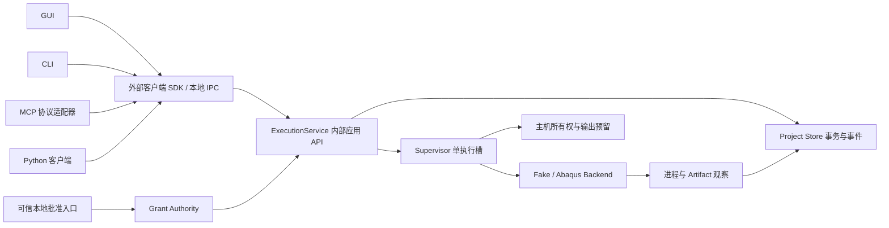

# Agent-first Run 001 — ADR 与执行契约

日期：2026-10-21（Asia/Shanghai）。状态：**设计提案，供审查；未实现，未授权执行**。应用目标为 `0.3.0`，开发标识为 `0.3.0.dev0`；本文中的协议示例不改变现有 API/JSON/Project/数据库 Schema。

依据：[BASELINE.md](BASELINE.md)、[ARCHITECTURE_REVIEW.md](ARCHITECTURE_REVIEW.md)。现有执行机制以已核验的 `main@1a509d322765d3c7b8046b5bc5708a63e4e22cda` 为参照。本文所有新类型、方法名和状态均为目标设计，不应据此调用现有生产代码。

## ADR 1 — 显式上下文与单机服务边界

决策：渐进引入单机模块化 ExecutionService，运行于独立执行所有者进程。GUI、CLI、外部 Python SDK、MCP 作为客户端，先共享一个主机级执行所有者、一个执行槽；不引入远程集群、分布式调度或多个独立 Solver 执行者。



内部应用 API 只在服务进程中使用，接收已解析且验证过的 ProjectContext；它能组织事务和 Backend。外部 SDK 只封装 IPC DTO、错误和重连，不导入 QueueRunner，不直接写 Project 数据库，不依赖服务模块导入的全局配置。GUI Agent Console 也走这个边界。现有 `api.AbqJobPilotClient` 是本地文件操作门面，不应直接改名后宣称已经成为远程/进程外 SDK。

ProjectContext 为不可变值，至少包含：

| 字段 | 语义与约束 |
| --- | --- |
| `project_id` | 逻辑 Project 身份；校验 manifest，不能由 GUI 当前选择代填 |
| `project_instance_id` | 服务登记的本机实例身份；绑定实际根目录的文件系统身份与存储实例，复制 Project 不能复用 |
| `root` / `runtime_root` / `execution_store` | 经过规范化、访问与格式校验的绝对路径；上下文创建后不变 |
| `manifest_digest` / `storage_generation` | 防止请求期间目录被替换、导入或迁移；每次写入和 dispatch 前复核 |
| `backend_id` / `host_id` / `owner_epoch` | 目标主机、适配器和所有者世代；不把 PID 当永久所有者身份 |
| `format_id` / `schema_version` | 显式选择 legacy 只读适配或新执行存储；查询不能创建/升级 |

职责：

- ExecutionService：解析上下文、校验计划/授权/幂等、接受与排队、控制语义、查询；不解析 Abaqus 日志细节。
- Supervisor：单槽调度、启动前再校验、持久启动意图、进程监督、崩溃恢复；GUI 退出不影响它。
- Abaqus Backend：把固定计划转为固定 argv/cwd/environment，采集 launcher 与候选 Solver 身份，生成观察；没有权限自行批准或提交 Run。
- Project Store：Job/Plan/Run/幂等/事件/验证记录的事务，提供纯查询；不启动进程、不自动修复。
- Host Coordinator：本机 owner 锁、全局槽限制与跨 Project 输出身份预留；不代替 Project 数据权威。
- 协议适配层：版本协商、序列化、错误和等待；不得补一套调度或批准逻辑。

新执行路径禁止访问可变 `config.RUNTIME_DIR`、GUI.current_project 或 Recent 的“最近一个 Project”作为默认上下文。Recent 只是导航索引。现有旧路径先保留，显式入口选择格式，避免一次改完 GUI/Runner/数据库。

## ADR 2 — 对象、身份与兼容映射

| 对象 | 最少字段 | 不变式 |
| --- | --- | --- |
| `JobSpec` | `job_id, revision, project_id, input_refs, job_name, work_dir, requested_resources, requested_phases, metadata` | 一个逻辑任务的版本化意图；metadata 不提供权限 |
| `ExecutionPlan` | `plan_id, digest, job_id, job_revision, project_instance_id, input_manifest, config_snapshot, backend_identity, phases, argv, cwd, environment, resource_limits, output_policy, validation_policy, expires_at` | 固定、不可变、内容寻址；修改任何执行含义必须生成新计划 |
| `ExecutionGrant` | `grant_id, issuer, authority_instance, project_instance_id, plan_digest, subject, allowed_actions, limits, expires_at, max_runs, consumption` | 可信入口签发/登记；默认一次且仅能创建一个 Run |
| `Run` | `run_id, project_id, project_instance_id, job_id, job_revision, plan_id, plan_digest, grant_id, attempt_no, retry_of, owner_epoch, dimensions, revision` | **执行前持久化 run_id**；真正重试新建 Run；attempt_no 在事务中分配 |
| `ExecutionEvent` | `event_id, project_sequence, run_id, run_sequence, type, observed_at, recorded_at, owner_epoch, payload, evidence_refs` | 追加、不原地重写历史；状态变化与事件同事务提交；时钟不承担排序 |
| `ArtifactObservation` | `observation_id, run_id, phase_attempt_id, kind, resolved_path, file_identity, exists, size, mtime, digest, before_ref, observation_time, provenance, binding_status` | “观察到文件”与“由本 attempt 生成”分开；不能只凭路径绑定归属 |
| `ValidationRecord` | `validation_id, run_id, policy_id/version, validator_id/version, scope, result, evidence_refs, checks, reasons, recorded_at` | 保留 PASS/FAIL/UNKNOWN/NOT_RUN；无法完成的检查不得写 PASS |

每个 phase 启动有独立 `phase_attempt_id`，并关联所属 Run；MVP 每个固定阶段最多一次启动，不在同一 Run 内偷偷重跑失败阶段。以后引入阶段 Retry 需另行 ADR；当前真正 Retry 创建新 Run。

现有身份兼容：

| 现有接口/字段 | 现有真实含义 | 兼容策略 |
| --- | --- | --- |
| queue.json `queue_id`，`q_<uuid>` 或旧时间戳 | 一条队列记录/一次排队尝试 | 保留字符串，作为 `legacy_queue_id` 显式关联，不重新编号 |
| legacy API `enqueue/status/locate_outputs` 的 `job_id`，CLI `status --job-id` | 实际为 queue_id 的别名 | 旧 surface 1.0 不改含义；新接口用 `queue_id` 或 `run_id`，不得同名悄悄改成逻辑 Job |
| Project DB `jobs.job_id` / Project `show_job` | Project 内逻辑 Job，当前由规范化 INP 路径与 job_name 等归类 | 新协议 `job_id` 固定为逻辑 Job；旧入口加 namespace/类型说明 |
| DB `runs.run_id` | history 同步时才生成的数据库 attempt ID | 保留既有 ID；迁移只能称“导入历史 Run”，不能声称它在原执行前就存在 |
| MCP `scope=queue` / `scope=history` + identifier | 分别是 queue_id / 逻辑 job_id | 旧工具保留；新工具采用显式类型字段，不根据前缀猜测 |

不以 INP 路径/文件名作为新 Job 的全局身份。一个逻辑 Job 可以有多个 revision；两个意图相同但独立创建的 Job 不共享授权。任何新 API 的 `job_id`、`run_id`、`queue_id` 均有唯一语义。

## ADR 3 — 状态、证据与结构化错误

状态分维度存储和返回，UI 可以提供派生摘要，但不得覆盖原维度：

| 维度 | 示例值 | 说明 |
| --- | --- | --- |
| 请求 | `REJECTED / ACCEPTED / REPLAYED` | ACCEPTED 必须有已提交的接收记录；RPC 收到字节不等于接受 |
| 排队 | `NOT_QUEUED / PENDING / DISPATCH_RESERVED / DISPATCHED / CANCELLED_PENDING` | ACCEPTED 可能已终态重放；是否排队单独可见 |
| 执行 | `PLANNED / PREPARING / START_INTENT / OBSERVING / VALIDATING / FINISHED` | 具体 phase 另列 DATACHECK/FULL/FAKE，不混用业务判定 |
| 进程观察 | `NOT_STARTED / LAUNCHER_ACTIVE / CHILD_ACTIVE / OBSERVATION_UNKNOWN` | PID、创建时间、可执行文件与关系证据各自可查 |
| 退出验证 | `NOT_OBSERVED / LAUNCHER_EXIT_ONLY / TRACKED_EXIT_CONFIRMED / UNKNOWN` | `TRACKED_EXIT_CONFIRMED` 仍需记录覆盖范围，不等于完整进程树证明 |
| Solver 结论 | `NOT_RUN / PASS / FAIL / UNKNOWN` | 需本 attempt 的阶段证据；exit=0 不是单独充分条件 |
| Artifact 验证 | `NOT_RUN / OBSERVED / VALID / INVALID / UNKNOWN` | ODB 存在、可打开、数值检查通过是不同检查 |
| 对账要求 | `NONE / RECONCILIATION_REQUIRED` | 表示不能安全决定下一步，不是 Solver 已失败/已停止 |

`UNKNOWN` 是证据不足的结论，可出现在多个维度；不能自动转换成 FAILED/COMPLETED。`RECONCILIATION_REQUIRED` 是操作门禁：保持输出预留，禁止同身份重复启动，要求新观察和显式对账。客户端可继续查询，不能通过“重试请求”清除它。

成功至少要求：计划中所有必选阶段完成；本次阶段输出可归属；所要求的退出验证、Solver 判定、Artifact 验证均通过；相应证据与终态事务已持久化。只有 Datacheck 的计划允许 `solver.scope=DATACHECK` 的成功，不宣称 FULL 或 ODB 验证成功。

结构化错误示例（协议草案）：

```json
{
  "contract_version": "agent-first-draft-1",
  "request_status": "REJECTED",
  "error": {
    "code": "PLAN_STALE",
    "stage": "PRE_DISPATCH",
    "message": "An input dependency differs from the approved plan",
    "project_id": "p_demo",
    "run_id": "r_demo",
    "evidence_refs": ["ev_input_recheck_12"],
    "retry": {"allowed": false, "kind": "NEW_PLAN_AND_GRANT", "preconditions": ["rebuild_plan", "trusted_approval"]},
    "requires_reconciliation": false
  }
}
```

| 错误码 | 能否直接重发同请求 | 后续条件 |
| --- | --- | --- |
| `IDEMPOTENCY_CONFLICT` | 否 | 同键内容冲突，查询原请求；新意图用新键 |
| `PLAN_STALE` | 否 | 新计划、新批准；旧 Run 保留拒绝调度证据 |
| `GRANT_REQUIRED/EXPIRED/REVOKED/SCOPE_MISMATCH` | 否 | 可信入口重新批准；Agent 自报同意无效 |
| `PROJECT_IDENTITY_MISMATCH/UNSUPPORTED_FORMAT` | 否 | 明确选择正确实例或单独迁移，查询不修复 |
| `RESOURCE_LIMIT/OUTPUT_CONFLICT` | 条件允许 | 未接受的请求可在资源释放后重发；已接受者查询同 Run，不新建 |
| `OWNER_UNCONFIRMED/LAUNCH_OUTCOME_UNKNOWN` | 否 | 对账身份、进程和输出；禁止自动重新 launch |
| `STORE_UNAVAILABLE/EVIDENCE_WRITE_FAILED` | 视提交是否可证实 | 查询幂等记录；不能确定提交就报未知，保持门禁；已启动进程继续观察 |
| `VALIDATION_FAILED` | 不能重跑旧 Run | 新 Retry 意图、计划和授权；保留旧失败证据 |

错误引用稳定 `event_id/observation_id`，日志字符串只是补充。不可用异常文案的字符串匹配代替协议错误码。未知/矛盾观察也要落事件，不能以 live status 写入失败为由假装完成。

## ADR 4 — 固定计划和可信授权

计划必须固定：完整输入依赖、含 include 的递归清单与解析器版本、文件身份和内容摘要；Settings 实际持久值及 defaulted_fields；实际 argv（含 datacheck 是否省略 GPU）、cwd、受控环境变量与允许的可执行入口；Backend/安装身份；CPU/GPU、单槽、墙钟观察期限、存储限额；输出身份、是否拒绝已有结果、验证检查与失败处理。

输入包括外部 include、材料表、用户子程序及其二进制依赖、重启输入等实际会读取的依赖。无法解析/固定的依赖令计划为 `UNSUPPORTED_DEPENDENCY`。预览直接渲染固定计划，不再独立调用一套命令构建器。

提交与实际 dispatch 前分别复核 Project 实例、输入/配置摘要、Backend 身份、授权期限、资源/输出策略。配置变化会使原计划失效，即使默认值碰巧相同也必须按定义的配置 revision/digest 判定，不能执行时重新加载未批准的 Settings。

散列检查到进程读取之间仍有 TOCTOU 窗口。MVP 使用 Fake Backend 的已固定输入内容；真实 Backend 必须提供经验证的输入固定方法（例如用户明确允许的不可变执行快照及其路径映射），或证明受控输入在整个执行读取期间保持不变。**不能默默复制工程文件**：这受既有 FILE-OWNERSHIP-001 约束。无法保证时拒绝声称计划严格绑定，保留为真实 Backend 发布门禁。

默认 ExecutionGrant 绑定一个明确的 plan digest、Job revision、Project instance、authority instance 和最多一个 Run；有限范围授权只有在显式批准了确切允许的 Job/Plan 集合、总预算、期限、输出集合、最大次数后才可支持。不得接受“这个目录下面任何新任务”这种可扩张授权。Retry 默认需要新批准。

批准流程：

1. Agent 只能请求计划并展示其摘要，不能调用批准管理端点。
2. 本地可信批准 UI 展示 Project/实例、Job revision、所有输入、命令、资源、输出冲突策略和验证要求。由用户对固定摘要确认。
3. Grant Authority 签发不可猜测 grant_id，并在权威登记中保存批准来源、期限、范围和撤销记录。服务按自身登记验证；`approved=true`、聊天文字、客户端 issuer 均不是授权证明。
4. 提交事务记录 grant 消耗与 Run；幂等重放不会再消耗，过期不会撤销已成功接受的 Run 查询，但**启动前**必须仍有有效启动许可。MVP 的排队等待超过期限则不启动，要求新批准。

可信批准 UI 可以与 GUI 共用展示组件，但使用独立、受控的批准通道；普通 SDK/MCP 只有 plan/submit/query/control 能力，没有 mint_grant。批准令牌不写入普通日志/可导出的 Project 归档。任何导入、复制、备份恢复后的新实例都无活跃授权；原 grant 绑定的 host registry 与 project_instance_id 无法随复制继承。

同一 OS 用户且拥有任意 shell、调试、文件写入权限的 Agent 可以修改服务二进制、数据库、输入甚至批准程序。应用层 token、独立进程、同用户文件 ACL **不能形成防恶意同用户的强安全边界**。本设计防止正常接口误用/重放，不声称抵御该对手。若需要不可绕过的人类批准，必须在另一个受控 OS 身份/权限域或外部批准服务建立隔离；属于独立部署与验收范围。

## ADR 5 — 幂等、所有权、输出预留与恢复

幂等键命名空间为 `(project_instance_id, client_namespace, operation, idempotency_key)`，摘要包含规范化请求的全部执行语义、plan digest、grant_id、retry_of；不包含传输 deadline、trace id 等非语义字段。规范化规则版本化，不能依赖字典序、路径大小写或浮点随意格式化。

同键同摘要：返回原已提交的接收结果、同一 Run ID、当前状态及 replay 标志；绝不再次 launch 或消耗授权。同键不同摘要：返回 `IDEMPOTENCY_CONFLICT`，不覆盖旧记录。并发时靠数据库唯一约束和事务竞争，不靠内存缓存。超时重发也必须用同键。新 Retry 用新键、新 Run、新 attempt_no，填 `retry_of=旧 run_id`，保留逻辑 Job 关系与旧 Run。

单个 Project 事务提交以下内容：幂等请求摘要/接收结果、授权消耗凭据、Run/队列状态、相关事件。主机预留与 Project 数据库不是跨库原子事务，采用明确的保守顺序：

1. 取得主机 owner 锁；分配 owner_epoch；验证旧世代没有待对账的活动 Run。
2. Project 接收事务先持久化 `PENDING` Run。跨 Project 同输出的请求可以已接受但未 dispatch；MVP 若同步拒绝冲突，也必须返回明确“未排队”语义。
3. 在主机全局注册表中独占预留规范化输出身份和单执行槽，写持久 reservation_id，再向 Project 提交 `DISPATCH_RESERVED/START_INTENT` 事件及该 reservation 引用。
4. 再验证计划、授权及 owner 身份，调用 Backend 一次。启动后记录 launcher/子进程身份与启动观察。
5. 证据文件先完整写入并校验摘要，再以同一 Project 事务提交观察、验证结论、状态和事件。可有未引用的临时证据文件，不能有伪造的成功引用。
6. 仅在已验证终止且最终事务可确认后释放主机输出预留和槽。无法确认则持久标为 RECONCILIATION_REQUIRED；服务重启不会凭 OS 锁已释放就清空预留。

主机资源上限、同 Project 事务互斥和输出身份保护是三件事。所有参与的 Project 共用 Host Coordinator。输出 key 至少包含真实卷/目录文件身份、规范化 basename 与输出族；已存在文件还记录其 file identity。Windows 大小写、junction/symlink、8.3/UNC 别名不可只用字符串比较。MVP 只接受可确认身份的本地目录，不支持的网络路径/别名返回明确错误。外部直接启动的 Solver 不服从此锁，仍需本机进程/`.lck`/已有输出预检；不能宣称系统级排他。

| 崩溃点 | 重启后的动作 |
| --- | --- |
| 接收事务之前 | 无 Run 则同键可重新请求；提交结果不明时先查幂等记录 |
| 接收提交后、主机预留前 | 同一 PENDING Run 可继续校验与调度，不新增 Run |
| 主机预留后、Project START_INTENT 前 | orphan reservation 保留；对照双方持久记录后显式释放或恢复，不盲目清空 |
| START_INTENT 提交后、Popen 前 | 即使可能尚未启动，也不能凭缺 PID 自动重启；与下一窗口无法总是区分 |
| Popen 后、PID/启动结果持久化前 | `LAUNCH_OUTCOME_UNKNOWN`；保留预留，调查实际进程与输出，禁止自动第二次启动 |
| launcher 退出、子进程活跃或未覆盖 | 继续观察/对账；不启动下一阶段，不释放槽/输出 |
| 证据生成后、终态事务前 | 重新读取证据与进程观察后幂等完成同一 Run；不重跑 Solver |
| 终态提交后、应答前 | 查询/同键重放返回原结果 |
| 终态提交后、主机预留释放前 | 能验证终止、终态和预留身份时显式完成释放；保守泄漏优于重复执行 |

不承诺可证明不了的 exactly-once。可保证“一个幂等接收记录”“不因普通重发再提交”“不确定启动时禁止自动重复”，无法凭事务实现外部进程与数据库原子提交。owner_epoch 用于拒绝旧 owner 的新写入/调度，不能让已逃逸 Solver 自动停止。

## ADR 6 — 数据权威、迁移与回退

Legacy 格式维持现状：queue.json 是控制状态，live_status.json 是观察，report 是历史输入，project.db 是单向历史投影。仅旧 writer 写旧格式；禁止新服务和旧 GUI 同时管理同一执行实例。

目标新格式使用 Project 内**独立的事务执行库**（拟定 `execution.db`；正式名称/版本由实现迁移评审冻结），以区别现有 `project.db` history schema。Job/Plan/Run/幂等、grant 消耗凭据、ExecutionEvent、ArtifactObservation、ValidationRecord 在同一库中；状态版本与事件事务一致。大型证据文件留 Project 的 evidence 目录，以摘要引用，不在数据库放 ODB/CAE BLOB。主机所有权/输出注册表只管理主机调度，非 Project 业务状态第二权威。

新格式如需导出 legacy JSON，只允许只读快照/派生视图，并标记 provenance、sequence 和非控制用途；不允许长期双向同步 JSON 和 SQLite。导出不能成为旧 Runner 的可执行 queue。

本轮不创建任何生产新库、不迁移数据。未来迁移必须是独立显式命令：

1. 停止新 dispatch，确认所有活动/不明进程已解决；取独占维护锁。
2. 检查旧格式、schema、WAL 和版本兼容，做一致性备份并验证可恢复；无授权不迁移。
3. 在新目标实例构建新格式，记录源文件摘要、旧身份映射和 import provenance；旧历史验证记录标为 `LEGACY_UNVERIFIED/NOT_RUN`，绝不补造当时不存在的 Run 创建时间、批准、进程身份或结果检查。
4. 验证记录数、身份映射、外部引用与缺失文件清单；签发新的 project_instance_id，授权表为空，待执行项默认不可执行。
5. 显式切换唯一 writer。旧客户端必须拒绝新格式执行；由于现有旧版未必识别新 marker，迁移产物不提供可被旧 `load_project_info` 接受的活动 legacy queue，使用独立目录/manifest contract，不能只加一个被旧版忽略的字段。

回退是恢复完整备份到独立 legacy 实例并明确选择旧 reader/writer，不让旧程序就地降级新库。新 Run 已执行时，回退不能使其输出/授权/幂等历史“消失”；须先核对主机预留与实际进程，新的结果以证据导出保留。未知 schema 只返回兼容错误，查询、打开、重连都不能隐式迁移、初始化或 reconcile。

## ADR 7 — 控制与首版范围

| 操作 | 精确定义 | 不包含的作用 |
| --- | --- | --- |
| `pause_dispatch` | 持久化 host/project 调度门状态，关闭后续派发；单槽首版明确作用域 | 不挂起/杀死正在运行的 Solver |
| `resume_dispatch` | 幂等打开门；重新校验计划、授权、所有权和资源后才能启动 | 不自动重试失败或未知 Run |
| `cancel_pending(run_id)` | 在事务中仅将尚未获得 dispatch 权的 PENDING Run 取消并写事件；与 dispatch 竞争只有一方胜出 | 不删除历史；START_INTENT 以后返回 `TOO_LATE_TO_CANCEL_PENDING` |
| `stop_after_current` | 若有当前 Run，让它包含 Datacheck/Full/验证的整个生命周期结束后暂停 dispatch；若无当前 Run，立即暂停 | 不将 Datacheck 阶段结束当“当前任务完成”，不终止子进程 |

暂停、恢复、取消也是带幂等键/版本前置条件的服务命令，不能用客户端断线代替。Supervisor 重启后恢复调度门状态；暂停状态不会因新客户端连接消失。取消已接受但未启动 Run 的授权不自动返还供别的 Job 使用，重新使用需要显式批准政策。

Solver suspend/resume/terminate 是独立 Backend 能力，首版 `supported=false`。未经目标 Windows/Abaqus 版本及进程树验收，不显示可用按钮或承诺其效果；资源上限触发时先记录并停止后续 dispatch，不能暗中把超时当作杀进程授权。

MCP 请求超时、断线、客户端取消等待只结束该 RPC/wait。服务中持久 Run 继续由所有者监督；连接恢复后通过 run_id/idempotency_key + event cursor 查询。传输取消不是 cancel_pending，更不是 terminate。

## 草案接口与可审查样例

内部接口示意（不可直接执行）：

```text
PlanService.prepare(ProjectContext, JobSpec, policy) -> ExecutionPlan
GrantAuthority.approve(trusted_session, plan_digest, limits) -> ExecutionGrant
ExecutionService.submit(ProjectContext, plan_id, grant_id, idempotency_key) -> SubmissionReceipt
ExecutionService.query_run(ProjectContext, run_id) -> RunView
ExecutionService.events(ProjectContext, after_sequence, limit) -> EventPage
ExecutionService.retry(ProjectContext, retry_of, new_plan_id, new_grant_id, idempotency_key) -> SubmissionReceipt
ExecutionService.control(ProjectContext, action, run_id?, expected_revision, idempotency_key) -> ControlReceipt
```

外部请求使用显式 Project selector；服务解析为上下文，拒绝路径、project_id 与 instance_id 矛盾：

```json
{
  "contract_version": "agent-first-draft-1",
  "operation": "submit",
  "project": {"project_id": "p_demo", "instance_id": "pi_local_demo", "root": "<TEMP_PROJECT>"},
  "plan_id": "plan_demo",
  "plan_digest": "sha256:<canonical-plan-digest>",
  "grant_id": "grant_issued_by_trusted_entry",
  "idempotency_key": "clientA/request-001"
}
```

```json
{
  "request_status": "ACCEPTED",
  "replayed": false,
  "run_id": "r_created_before_launch",
  "job_id": "j_logical_job",
  "queue_status": "PENDING",
  "execution_phase": "PLANNED",
  "process_observation": "NOT_STARTED",
  "exit_verification": "NOT_OBSERVED",
  "solver_conclusion": "NOT_RUN",
  "artifact_validation": "NOT_RUN",
  "reconciliation": "NONE",
  "project_sequence": 3
}
```

事件分页以服务分配 sequence 为游标；断线重放可重复交付，客户端按 event_id 去重。MVP 不删除事件，因此重连可追全；未来保留策略必须返回 `CURSOR_EXPIRED` 与一致快照，不能静默跳过事件。Read API 不发起 DB 初始化、历史投影、批准或重跑。

## 被否决的捷径与待决细节

否决：让 MCP 直接调用 QueueRunner.start；保留 GUI 进程当 owner；只加 `approved=true`；把旧 job_id 改含义；靠 `.lck` 存在性代替全局输出预留；自动清 stale owner 后重试；把 queue.json 与 SQLite 双向同步作为长期方案。

实现前还需冻结：本地 IPC 具体传输及访问控制、主机注册表位置与恢复操作、canonical JSON 规则、文件系统别名规范化支持范围、真实 Backend 输入固定策略与验证器。Run 002 只应落实最小契约切片；完整 MVP 与真实 Solver 验收分别推进，见 [MVP_ACCEPTANCE_MATRIX.md](MVP_ACCEPTANCE_MATRIX.md)。
