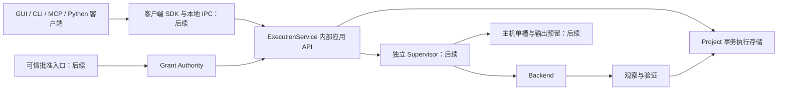

# Run 001R — ADR 修订与最小契约

日期：2026-10-21。状态：**设计冻结供实施，尚未实现**。事实基线见 [BASELINE.md](BASELINE.md)，现状见 [ARCHITECTURE_REVIEW.md](ARCHITECTURE_REVIEW.md)。本文取代旧提案在本轮施工中的指导地位，不修改 [Run 001 原文](../run_001/ADR_AND_CONTRACTS.md)。所有新增类型、协议、schema 名称均是拟议值，不改变当前应用或持久化 Schema。

## 相对原七项 ADR 的修订

| ADR | 保留 | 本次修订及理由 |
| --- | --- | --- |
| 1 上下文/服务 | 显式 Project、单机模块化服务、单槽、独立所有者、共用服务 | backend/config 移到 Plan；owner/epoch/PID 移到 Supervisor/Run。内部 API 可先单进程验证，独立进程不是 Run 002 前提 |
| 2 对象/身份 | 七种对象、pre-launch Run、旧 ID 兼容、不按文件名授权 | 冻结实验对象字段与 Fake phase；补充不可变 SubmissionReceipt，重放不是新的接受状态 |
| 3 状态/证据 | 分维度、UNKNOWN、RECONCILIATION_REQUIRED | Fake completion 独立于 Solver/Artifact；纠正“已接受 Run 的 dispatch 失败又把请求改成 REJECTED”的示例 |
| 4 计划/授权 | 固定输入配置资源输出验证、可信批准、不接受 approved=true | 区分测试夹具授权和未来真实 Grant Authority；Dev 缺严格 Settings 持久化校验，Run 002 不读旧 Settings |
| 5 幂等/恢复 | 同键同摘要重放、冲突拒绝、Retry 新 Run、不承诺 exactly-once | 固定摘要规则、事务边界；Run 002 只验证单进程服务与关闭后只读重开，不承诺进程崩溃恢复 |
| 6 权威/迁移 | Project-owned Data、独立执行库、单一 writer、无 JSON/DB 双向写 | 首个存储仅新建临时实验 Project，独立 manifest/format，旧 project.db 不打开、不迁移 |
| 7 控制/范围 | pause/resume dispatch、cancel pending、stop after current；传输取消不杀 Run | 完整目标保留这些控制；Run 002 不实现 GUI/MCP、IPC、独立监督及 Solver 控制 |

## ADR 1 — 上下文与服务职责

完整目标：单主机的独立执行所有者进程管理一个槽。GUI、CLI、Python 客户端 SDK、MCP 共同访问内部 ExecutionService；不让每个客户端自行成为执行所有者。



Run 002 只实现内部 ES/Store/Plan/测试 Grant/Fake/Validation 的单进程链路，不声称图中整个架构已实现。

| 值 / 组件 | 职责与归属 |
| --- | --- |
| `ProjectContext`（不可变） | `project_id, project_instance_id, root, runtime_root, execution_store, format_id, schema_version, storage_generation, manifest_digest`。前两项为逻辑/本地实例身份；路径为已解析定位；后三类标识用于防止格式、代际或 manifest 被替换。不是 Settings 容器 |
| `ConfigSnapshot`（Plan 内） | `config_revision, values, digest, source, defaulted_fields`；资源、Backend ID/version、phase、输入/输出/验证政策都固定于 Plan。Run 002 source 只能为显式 fixture configuration |
| ExecutionService | 校验 context、Plan/Grant、幂等、接受与查询、协调 Run 状态事务；不解析 Abaqus 输出，不持有 GUI 状态 |
| Supervisor（后续） | 独立进程生命周期、owner_id/epoch、host_id、dispatch、启动意图、launcher/后代监督与恢复。Run 记录实际 owner/epoch；PID 创建时间等在进程观察中，不是 Project 身份 |
| Backend | 接收已校验固定计划，产出带来源的观察；不能签发授权或另行提交 Job。Fake 没有进程能力；Abaqus Backend 后续提供 |
| Project Store | 唯一执行事实源：receipt、Run、幂等记录、grant 消耗、event、observation、validation 事务；显式创建和纯读取分离 |
| Host Coordinator（后续） | 同 Project 串行化以外的主机槽、owner fencing 和跨 Project 输出身份预留；不成为 Job/Run 的第二权威 |
| 协议适配/外部 SDK（后续） | DTO、版本、错误、连接与等待；不直接写 DB，不导入 Runner，不自行批准。现有 `AbqJobPilotClient` 是本地门面，不能直接改名冒充该 SDK |

执行 API 必须显式传 ProjectContext。不得从 GUI 当前 Project、`config.RUNTIME_DIR` 或 Recent 列表推断。context 建立时、写入前与 dispatch 前核对 root/manifest/实例一致性；path 和 ID 同时存在而矛盾时拒绝，不能优先采用其中一个。

Project-owned Data 保留：执行元数据、证据账本归 Project；外部 CAE/INP/ODB 等保持引用。禁止默认复制、移动工程文件。实验输入是临时根内的普通 `.txt` 文件，不生成 CAE/INP/JNL 作业。

## ADR 2 — 对象与身份

| 对象 | 冻结的必要字段 / 不变式 |
| --- | --- |
| `JobSpec` | `job_id, revision, project_id, project_instance_id, input_refs, requested_resources, metadata`；job_id 代表逻辑 Job，revision 改变内容；metadata 无授权作用 |
| `ExecutionPlan` | `plan_id, plan_digest, job_id, job_revision, project_instance_id, context_digest, input_manifest, config_snapshot, backend_id/version, phases, action, resources, output_policy, validation_policy, expires_at`；创建后不可修改 |
| `ExecutionGrant` | `grant_id, issuer, authority_instance, grant_kind, project_instance_id, plan_id/digest, job_id/revision, allowed_action, resource_limits, output_scope, expires_at, max_runs=1`；由可信登记验证，不接受提交者自报 issuer |
| `SubmissionReceipt` | `request_id, namespace, idempotency_key, request_digest, accepted_at, run_id, job_id, accepted_sequence, initial_queue_state=PENDING`；接收事务成功后不可变。返回 envelope 可另有 `replayed` |
| `Run` | `run_id, project_id/instance_id, job_id/revision, plan_id/digest, grant_id, attempt_no, retry_of, phase_attempt_id, dimensions, revision, owner_id/epoch`；接受事务内创建，早于任何 Backend 副作用 |
| `ExecutionEvent` | `event_id, project_sequence, run_id, run_sequence, type, observed_at, recorded_at, payload, evidence_refs`；追加不可覆盖，序列由事务分配，不能用时钟排序替代 |
| `ArtifactObservation` | `observation_id, run_id, phase_attempt_id, kind, path, file_identity, exists, size, mtime, digest, provenance, binding_status`；记录本次观察而不是覆盖旧 run 的 stat；缺少归属证据标 UNKNOWN |
| `ValidationRecord` | `validation_id, run_id, phase_attempt_id, scope, policy_id/version, validator_id/version, verdict, evidence_refs, reasons, recorded_at`；verdict 为 PASS/FAIL/UNKNOWN/NOT_RUN，须标 `simulation` 或 `solver` scope |

完整目标可有 DATACHECK/FULL 多 phase，但一个 Run 内不暗中重跑 phase。Run 002 只有一个 FAKE phase；phase_attempt_id 仍存在，便于证据归属。真正 Retry 是新 key、新 Plan/Grant、新 Run、新 attempt_no，并保存同 Project/Job 的 `retry_of`；最小切片可通过普通 submit 的 `retry_of` 表达，无需单独 Retry endpoint。拒绝 retry_of 指向不存在、其他 Project/Job 或尚未终结/待对账的 Run。

| 当前字段 | 实际含义 | 兼容契约 |
| --- | --- | --- |
| queue.json `queue_id` | 一条旧队列尝试，当前通常 `q_...` | 原 ID 原样保留，未来映射 `legacy_queue_id`，不生成同名逻辑 Job |
| legacy API `enqueue/status/locate_outputs.job_id`；CLI 相应 `--job-id` | queue_id 别名 | 旧接口不改语义；compat adapter 显式标 `legacy_queue` namespace |
| Project `show_job.job_id` / DB `jobs.job_id` | 逻辑 Job；当前 `_logical_key` 归类 | 新接口 job_id 永远表示逻辑 Job；不凭 ID 前缀猜类型 |
| 当前 DB `runs.run_id` | history 投影生成的 attempt | 不伪称历史 Run 在执行前已存在；迁移时保留 provenance |
| MCP `scope=queue/history, identifier` | 分别 queue_id / 逻辑 job_id | 旧工具保持；未来新 Run 查询用专用 run_id 字段 |

Run 002 无 legacy queue，返回 `queue_id: null`，不将 run_id 塞入 queue_id/job_id。不创建旧队列兼容写入器。

## ADR 3 — 状态、证据、错误

| 维度 | 契约值 / 语义 |
| --- | --- |
| 请求 | `REJECTED / ACCEPTED / ACCEPTANCE_UNKNOWN`；重放通过 envelope.replayed 表示，receipt 不改写。未知提交先查询同幂等键 |
| 排队 | `NOT_QUEUED / PENDING / DISPATCHED / CANCELLED_PENDING / BLOCKED` |
| 执行 | `PLANNED / START_INTENT / EXECUTING / VALIDATING / FINISHED / BLOCKED`；phase 单独保存 |
| Backend outcome | `NOT_RUN / COMPLETED / FAILED / UNKNOWN`，附 backend_id 和 simulation 布尔值 |
| 进程观察 | `NOT_STARTED / NOT_APPLICABLE / LAUNCHER_ACTIVE / CHILD_ACTIVE / UNKNOWN`；Fake 为 NOT_APPLICABLE，不伪造 PID |
| 退出验证 | `NOT_OBSERVED / NOT_APPLICABLE / LAUNCHER_EXIT_ONLY / TRACKED_EXIT_CONFIRMED / UNKNOWN`；最后一项确认只覆盖已观察身份 |
| Solver 结论 | `NOT_RUN / PASS / FAIL / UNKNOWN`，scope 明确 DATACHECK/FULL；Fake 永远 NOT_RUN |
| Artifact validation | `NOT_RUN / VALID / INVALID / UNKNOWN`；文件存在是 observation，不是 VALID |
| 对账 | `NONE / RECONCILIATION_REQUIRED`；表示不可安全继续，不表示 Solver 已停止 |

`UNKNOWN` 是证据不足，不是自动 FAIL 或 PASS。`RECONCILIATION_REQUIRED` 是继续派发的门禁；不释放冲突输出、不自动重复执行。Run 002 只展示这个语义和失败后停止，不实现对账修复工作流。查询可返回 `reconciliation_requirement` 派生视图及理由，但不得借此更新持久状态。

Fake 写出结果后仍须独立 validator 校验内容、run/phase ID、计划摘要、文件摘要和输出位置。可出现 `backend_outcome=COMPLETED` 与 `artifact_validation=INVALID`；两者并存，Solver 仍 NOT_RUN。完整真实成功需必选 phase、退出证据、Solver 判定、要求的 Artifact 检查及终态证据提交全部满足；文件存在、launcher code=0、Fake 完成都不是充分条件。

错误统一字段：`code, stage, message, project_instance_id, run_id|null, evidence_refs, retry{mode, preconditions}, requires_reconciliation`。持久化后错误引用 event/observation ID；未接受错误可直接附输入摘要差异，不能编造持久 event ID。

| code | 请求/Run 效果 | 重试规则 |
| --- | --- | --- |
| `IDEMPOTENCY_CONFLICT` | 不创建新 Run，不改旧 receipt | 修正客户端 key 使用；新意图另用 key |
| `PROJECT_IDENTITY_MISMATCH / UNSUPPORTED_FORMAT` | 接受前拒绝 | 明确正确实例；不能自动导入/迁移 |
| `PLAN_STALE / PLAN_EXPIRED` | 接受前拒绝；接受后则 Run dispatch BLOCKED，receipt 仍 ACCEPTED | 新计划、新授权、新 key；原 Run 不重跑 |
| `GRANT_REQUIRED / GRANT_EXPIRED / GRANT_SCOPE_MISMATCH / GRANT_CONSUMED / TEST_GRANT_ONLY` | 验证失败无 Backend 调用 | 由对应可信入口重新批准；测试 grant 永不升级成真实 grant |
| `RESOURCE_LIMIT / OUTPUT_SCOPE_VIOLATION / OUTPUT_CONFLICT` | 不启动 | 修改计划并重新批准；未来冲突释放也须已验证退出 |
| `STORE_UNAVAILABLE / ACCEPTANCE_UNKNOWN` | 未证实提交，不报告 ACCEPTED | 同 key 查询 receipt，确定后再处理；禁止换 key 盲重发 |
| `EVIDENCE_WRITE_FAILED / TERMINAL_COMMIT_FAILED` | 保留已接受 Run，停止进一步执行；终态未持久化不能报验证成功 | 查询与显式对账；不自动执行第二遍 |
| `VALIDATION_FAILED` | Backend 可完成、验证 FAIL，终态事件保留 | 真正 Retry 新 Run；不能重写旧 FAIL |
| `OWNER_UNCONFIRMED / LAUNCH_OUTCOME_UNKNOWN` | 完整目标保持预留并阻止 dispatch | 后续独立对账；Run 002 不实现真实 launch |

接受后配置变化的正确表达：`receipt.request_status=ACCEPTED`，`run.queue_state=BLOCKED`，`error.stage=PRE_DISPATCH`，`error.code=PLAN_STALE`，`backend_outcome=NOT_RUN`。不能回头把已提交请求变成“从未接受”。

## ADR 4 — 固定计划与可信授权

完整计划固定全部输入依赖（含 include/子程序/重启依赖及解析器版本）、配置快照、Backend/安装身份、argv/cwd/受控环境、phase、资源上限、输出冲突政策和验证要求。预览只能渲染该计划，不另读设置拼命令。提交和 dispatch 前复核输入/配置 revision、digest、Project 实例、授权期限与范围。无法固定依赖则拒绝，不能把未知依赖当空集合。

Run 002 简化但不弱化边界：

- `backend_id="fake-v1"`；action 只接受固定枚举 `emit_fixture_result`，禁止 executable/argv/shell、插件加载器、请求指定 Python callable 或动态 Backend import。
- input_manifest 只含明确临时根内 `.txt` fixture 的绝对规范路径、size、SHA-256；记录 config_revision/digest。Fake 产物根据固定计划生成，只读取已校验的 fixture bytes，不执行输入内容。提交前及 dispatch 前重读核对；同 revision 不同配置摘要也判 stale。
- resources 固定 `slots=1, simulated_cpus=1, simulated_gpus=0, max_output_bytes=65536`。这些是测试政策，非已实现的 OS 资源限制。
- 输出政策为 `runtime/fake_runs/{run_id}/result.json`，禁止 overwrite，拒绝请求任意输出路径。计划固定路径模板和根身份，run_id 由服务生成后按模板派生；不构成授权后修改计划。
- 验证政策为 `fake-result-v1`：JSON schema/size、simulation=true、run_id/phase_attempt_id/plan_digest 精确匹配、摘要、所属新输出目录。只输出 JSON/TXT，无 INP/CAE/JNL/ODB。
- 明确拒绝符号链接/junction/reparse 路径、越界 `..`、UNC/网络根、不支持的格式；所有文件都在调用方显式新建临时根下。不得以字符串前缀判断路径包含关系。真实文件系统别名完整覆盖留后续验收。

真实授权：未来受控本地批准 UI 或独立批准服务展示精确计划、Project、资源、输入/输出及验证要求，向 Grant Authority 登记。普通 Agent API 只具 prepare/submit/query 等能力，无 mint/approve 管理端点；`approved=true`、`allow_solver_submit=true`、客户端填 issuer 或聊天文字都不能成为许可。

测试授权：Run 002 由测试 harness 的 `FakeGrantFixture` 向实验 Store 登记 `grant_kind=TEST_ONLY, authority_instance=<fixture authority>`，绑定精确 Plan/Job/Project 与最多一次 Run，带期限。提交只收 grant_id，由服务查登记，拒绝 self-attested grant 对象。这个 fixture 只存在测试支持代码；新服务构造只允许 Fake，包内没有真实 Backend 路径。默认拒绝未知/真实 backend_id，不能以环境变量或开关启用真实执行。

授权消耗在接收事务记录到具体 Run；同键重放不再消耗，也不因授权后来过期而拒绝查询原 receipt。首次 dispatch 仍须在授权有效期内，且 consumption.run_id 必须是本 Run。新 Job、revision、新 Plan 不能借用旧授权；Retry 默认新授权。

同一 OS 用户拥有任意 shell/调试/改文件权限时，应用 token 与进程分离不是不可绕过安全边界。这里防正常接口误用；强对抗批准需要独立权限域。实验目录复制、导入、恢复不能继承活跃授权：fixture authority 绑定当前 harness 实例及所登记的根/instance，复制库可只读查看，不能变为新可执行实例。未来真实服务需主机登记/独立 authority 绑定，不把批准秘密与可导出 Project 一起复制。

哈希不是运行期间输入不变的证明。完整真实 Backend 的输入固定及 TOCTOU 问题仍需专项设计和实机验收；不得默认复制外部工程文件来绕过 Project-owned Data 原则。

## ADR 5 — 幂等、事务、所有权与故障窗口

幂等 namespace 固定为 `(project_instance_id, client_namespace, operation="submit", idempotency_key)`。请求摘要含 contract_version、Project/实例/context_digest、job_id/revision、plan_id/digest、grant_id、retry_of；不含 key 本身、传输 trace/deadline 或客户端显示字段。client_namespace 是服务配置的客户端身份，不随意从请求改名以绕过幂等。

实验规范化 `af-experiment-json-v1`：对象 key 排序，紧凑 JSON separators，UTF-8/ensure_ascii=false，禁止 NaN/Infinity/浮点数；schema 严格区分 bool/int，拒绝未知字段。列表顺序具有语义，字符串按原值编码。路径在 context/plan 构建时规范解析并核验，不能只把大小写折叠就宣称文件身份相同。digest 字段自身不参与本对象 digest；所有使用的 canonicalization version 记录入对象。为 Unicode、字段排序、布尔/整数及不同输入摘要写契约测试。

Run 002 内部调用顺序：

1. `create_experiment` 显式创建全新隔离临时 Project；唯一进程内 ExecutionService 持有 Store，两个客户端调用同一个 service。重复 owner 构造在本进程拒绝；不宣传跨进程所有权保障。
2. `prepare` 校验 context/spec/config/输入和固定输出政策，保存不可变 Plan；测试夹具登记精确 grant。
3. `submit` 先校验 context/schema，计算请求摘要并查 key。已存在同摘要返回原 receipt；不同摘要返回 conflict。已接受 key 的重放不重新跑 preflight/读取输入/dispatch，也不因当前文件变化失去原 receipt。
4. 新 key 校验 Plan/输入/配置/Grant/限制。在一个 `BEGIN IMMEDIATE` 事务中再次检查唯一 key、grant consumption，分配 attempt_no、run_id、phase_attempt_id，插入 receipt+Run(PENDING)+consumption+`REQUEST_ACCEPTED` event 后提交。仅提交已确认才返回 ACCEPTED；所有这些写入同时成功或回滚。
5. `execute_pending(context, run_id)` 是单进程实验 harness 明确调用的内部调度入口。仅允许当前 service 本次接受、尚未调度的 Run；验证 context/Plan/输入/配置/Grant，使用事务 compare-and-set 从 PENDING 提交 START_INTENT + event 后才调用 Fake。双客户端/重复 execute 调用只有一个取得该资格；失败或已完成返回状态，不再次调用 Fake。
6. Fake 输出完成与 validator 分开。先完整写入新 run 目录并计算摘要，然后事务提交 ArtifactObservation、ValidationRecord、Run 终态/维度及 event。可先记录 `FAKE_COMPLETED/VALIDATING` 事件；任何状态变化都与相应 event 同事务。验证 FAIL 也要持久化并保留 Backend 完成事实。
7. `open_existing_read_only` 重新打开后查询 receipt/Run/events/validation；不自动调度，不恢复执行所有者，不初始化。后续跨进程重启的写入恢复不在 Run 002。

数据库约束：unique(namespace,key)、unique(job_id,attempt_no)、unique(event_id)、unique(project_sequence)、unique(run_id,run_sequence)、grant consumption 默认 unique(grant_id)；所有 Run/事件/验证外键约束有效。事务提交冲突通过查询权威记录处理，不靠内存字典充当幂等存储。请求回执中的 accepted_sequence 是接收点；当前 Run 状态需另查，重放不改原 receipt。

| 故障窗口 | Run 002 要求 | 完整目标补充 |
| --- | --- | --- |
| 接收事务前/事务中失败 | 无已接受记录就无 Fake 调用；回滚不能遗留部分 receipt/Run/event | 同 key 查询确认提交结果 |
| 接收提交后、回执送达前 | 原 key 查询/重放得到同 Run；不自动 dispatch | IPC 超时重连同理 |
| START_INTENT 前 | 明确 pre-dispatch 失败持久为 BLOCKED；receipt 保持 ACCEPTED | owner 恢复后的可调度政策后续实现 |
| START_INTENT 后、Fake 调用或观察提交之间 | 不自动重跑；只读重开显示未完成及需要对账理由 | Popen 前后不可原子提交；LAUNCH_OUTCOME_UNKNOWN，保留输出预留 |
| 产物存在、验证/终态事务未提交 | 产物不是成功证据；留下未引用文件可报告，查询不清理 | 重验证/对账作为显式管理动作，不能重启 Solver |
| 终态提交后、响应前 | 重放/查询已持久结果，Fake 调用次数不增加 | 后续确认预留释放，不能凭连接断开释放 |

单进程逻辑失败注入可以进入 Run 002；kill 进程/跨进程崩溃恢复属于完整模拟 MVP。文件写入和 SQLite 事务仍不原子，不承诺 exactly-once；承诺正常重复请求不重复执行、持久资格只取得一次、不确定时不自动启动第二次。

完整目标另需区分：Project DB 事务锁；主机单槽资源；跨 Project 输出预留。后者在主机登记规范化卷/目录身份+basename+输出族，dispatch 前持久预留再提交 Project START_INTENT，owner_epoch 拒绝旧 owner 写入。失联不等于 Solver 已停，OS 锁释放不等于输出可用。网络路径/别名、外部自行启动 Solver 都须专项验证，不能将 `.lck` 存在检查称作全局排他。Run 002 不提供该协调器。

## ADR 6 — 实验存储、数据权威和迁移

Run 002 建议新文件格式 `format_id=abqjobpilot-agent-first-experiment, schema_version=1`：

```text
<explicit temporary test root>/
  recent-fixture.json       # 仅测试哨兵；服务不得读取或写入
  inputs/source.txt         # fixture 外部引用（相对 Project 外部，但仍在测试根内）
  project/
    experiment.json        # 新 manifest；不是 legacy project.json
    execution.sqlite3      # 唯一实验事实源
    runtime/fake_runs/<run_id>/result.json
```

创建操作拒绝已存在目标，不复用任何旧 Project。实验 manifest 不放旧 `application/schema_version` 组合的 `project.json`，不生成 queue.json/live_status.json，不创建 project.db，避免旧 GUI/Runner 将其识别成可执行旧队列。runtime_root 是本 Project 的实验输出位置，不调用 `config.use_runtime_dir`。execution.sqlite3 名称是实验内部格式，不是承诺未来正式迁移位置。

采用 stdlib SQLite，显式创建 schema，建议 DELETE journal + synchronous FULL，单实验 writer，不为该切片引入 WAL。只读打开先检查文件存在/格式，`mode=ro` + `query_only`，不走 ensure/initialize/migrate；有 hot journal、WAL sidecar 或不支持 schema 时明确返回 `STORE_REQUIRES_MAINTENANCE/UNSUPPORTED_FORMAT`，不试图修复。查询的文件清单/摘要不得变化；缺失库返回 NOT_FOUND 且不创建文件。本轮只设计，不创建此库。

旧格式唯一 writer 继续是旧 GUI/Runner/queue API，project.db 继续单向 history 投影；新实验库唯一 writer 为新 Service。两者不管理同一执行实例、不做双向 JSON/SQLite 同步。未来导出可做带 provenance/sequence 的只读视图，但不能生成可被旧 Runner 执行的活动 queue。

未来迁移必须独立授权：暂停派发并解决活动/未知进程，取得维护锁，检查格式与 WAL，做一致备份，在新实例显式转换、核验外部引用与计数，签发新 instance、授权清空，切换唯一 writer。未知格式拒绝；旧客户端不能就地修改新格式。回退恢复完整旧实例备份，保留迁移后 Run/证据，不能撤销已经发生的执行事实。历史无验证证据标 `LEGACY_UNVERIFIED/NOT_RUN`，不伪造批准、开始时间、退出身份或结果 PASS。

## ADR 7 — 控制语义与实施分层

完整目标控制：`pause_dispatch` 关闭后续派发，`resume_dispatch` 重新校验后开启；`cancel_pending` 与取得 dispatch 资格事务竞争，仅尚未启动的 Run 可取消；`stop_after_current` 等当前 Run 的所有阶段、进程退出验证和验证持久化完成后暂停，空闲时立即暂停。均不隐含 Solver suspend/terminate。暂停状态须持久化，重连不自动取消暂停。

Solver suspend/resume/terminate 为独立 Backend 能力，未通过目标环境验收前 supported=false。MCP 超时、断线或取消等待只结束等待，不隐含 cancel_pending 或终止持久 Run；独立 Supervisor 承担持续监督，不能把 Run 002 单进程实验称作已具备该能力。

| 层次 | 内容 | 是否 Run 002 |
| --- | --- | --- |
| A 内部契约 | 显式 context、固定计划、fixture grant、事务 receipt/Run/events/validation、幂等、Fake、纯查询 | 是，单进程、单槽、显式临时根 |
| B 完整模拟服务 MVP | 独立 Supervisor/owner fencing、IPC、多客户端、断线重连、跨 Project 输出预留、进程崩溃窗口、调度控制 | 否，后续 Fake/测试进程验收 |
| C 真实 Backend | Abaqus 配置/输入依赖固定、启动和子进程监督、结果与 ODB 验证 | 否，需另行授权与实机验收 |
| D 产品适配与发布 | GUI/CLI/MCP/SDK 共用服务、兼容/迁移/回退、发布0.3.0 | 否，按后续范围分步实施 |

## Run 002 接口示例（设计，不能据此调用旧 API）

```text
create_experiment(explicit_test_root, new_project_root) -> ProjectContext
ExecutionService(context, experimental_store, FakeBackend, fixture_authority)
service.prepare(context, JobSpec, ConfigSnapshot) -> ExecutionPlan
FakeGrantFixture.issue_exact(plan, context, expiry) -> grant_id  # 测试支持，不是公开 Agent API
service.submit(context, SubmitRequest) -> SubmissionEnvelope
service.execute_pending(context, run_id) -> RunView             # 内部实验驱动
readonly.query_receipt(context, client_namespace, key) -> Receipt
readonly.query_run(context, run_id) -> RunView
readonly.events(context, after_sequence, limit) -> EventPage
readonly.validations(context, run_id) -> ValidationRecord[]
```

```json
{
  "contract_version": "af-experiment-v1",
  "operation": "submit",
  "project_id": "p_fixture",
  "project_instance_id": "pi_fixture",
  "job_id": "j_fixture",
  "job_revision": 1,
  "plan_id": "plan_fixture",
  "plan_digest": "sha256:example",
  "grant_id": "grant_test_fixture",
  "idempotency_key": "request-001",
  "retry_of": null
}
```

root 来自已验证的显式 context；示例 ID/digest 只是占位，实际实现需严格验证。请求不得携带 approved、allow_solver_submit、任意输出目录或 Backend callable。

```json
{
  "request_status": "ACCEPTED",
  "replayed": true,
  "receipt": {
    "request_id": "req_fixture",
    "run_id": "r_fixture",
    "job_id": "j_fixture",
    "initial_queue_state": "PENDING",
    "accepted_sequence": 1
  },
  "queue_id": null
}
```

receipt 与当前状态分开查询；完成视图可为 `phase=FAKE, execution=FINISHED, backend_outcome=COMPLETED, process=NOT_APPLICABLE, exit=NOT_APPLICABLE, solver=NOT_RUN, artifact_validation=VALID, validation_scope=simulation`。事件游标按 sequence，重复交付按 event_id 去重；实验不删除事件，无隐式压缩或修复。

后续待定项为真实批准隔离域、本地 IPC、主机输出身份规范化、输入不变保障及 Abaqus 验证器；这些不进入 Run 002 构造依赖。具体施工文件和测试见 [MVP_ACCEPTANCE_MATRIX.md](MVP_ACCEPTANCE_MATRIX.md)。
