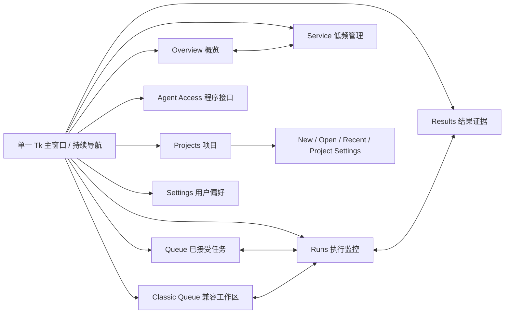

# 统一导航、Project 命名与行为契约

这是待确认的设计基线 v1，不是已实现产品。图稿入口：[design/index.html](design/index.html)。

## 信息架构

左栏始终存在，不使用“返回上一个独立程序”式按钮。前七项为工作区，底部 Service、Settings 为管理区；Runs 页标题可展开为 Execution Monitor。Project上下文条始终显示当前名称、类型/身份和连接状态；完整ID在详情可选中复制。每个页面保留自己的筛选/滚动/选中行，不重新提交或创建服务。

| 页面 | 主要问题 | 权威数据/已有接缝 | 本阶段交互边界 |
|---|---|---|---|
| Overview | 当前在做什么、是否需要注意 | project_view、run、gate、validations | 左Queue右Results；跳转Run；没有全局绿色“项目成功” |
| Projects | 我正在使用哪个项目 | product_project只读分类/打开/显式创建 | New/Open/Recent/Project Settings；近期记录仅用户选择历史，不能自动启动或连接 |
| Queue | 哪些任务已经接受及其顺序 | project_view及现有Run状态 | **只读已接受任务投影**；无拖拽重排、重试、批准、通用提交按钮；不建设新调度器 |
| Runs | 这次尝试到底发生了什么 | receipt/run/progress/events/validations/closeout preview | 分页、选择、查看身份与多维证据；只读历史，不重新探测OS |
| Results | 哪些结果得到何种验证 | 当前Run证据和验证记录 | 来源/实体/值/时间分开；不因文件存在标通过，不自动打开ODB或调用Viewer |
| Agent Access | Agent能用哪些接口、权限是什么 | Python产品客户端契约、Classic API/MCP能力 | 文档/无秘密连接说明；不签发Grant、不添加MCP写工具 |
| Classic Queue | 继续兼容原工作流 | 独立Classic Project/Runner/历史 | 保留原动作的上下文与准入；进入页不启动Runner或初始化默认Runtime |
| Service | 是否连接、谁拥有服务、能否安全停止 | ServiceLifecycleManager | 明确Start/Reconnect/Disconnect/Stop；后端决定准入；不Resume、不Kill、不放行UNKNOWN |
| Settings | 显示如何适合我 | 新用户偏好方案 | 语言/布局；不修改工程资源、Backend或Plan |

Overview的Queue/Results和独立Queue/Results页共享同一读取模型与选择，不复制写路径。当前公共列表是有界分页，首版不宣称“整个Project共N项”或全局搜索全部历史；搜索注明“本页”，跨页查询需后续公开API支持。Events保留全局游标但按Run过滤。

## 两种上下文不混用

壳层持有两种**显示上下文**：产品Project会话与显式Classic会话。它们不是同一个Project的两种外观。进入Classic时上下文条、表格、日志和页脚一起切换为Classic来源；返回Runs恢复产品Project选择。后台产品执行与导航独立。Classic未选择Project时只显示选择引导，不显示默认Runtime数据。

任何异步回复至少绑定 `(format_kind, project_id, instance_id, owner_id, selection_generation, run_id)`。切Project即增加代际，清当前详情；旧线程迟到消息不可覆盖新页。状态保存只能是UI选择，不保存/复制可用Grant、IPC秘密或owner权力。

原Classic列表的“完成/失败”不能提升成新Store的Solver/Artifact结论；产品Runs也不写旧历史库。两个会话引用同一工程路径并不获得互斥保护，首次版不提供合并列表或跨两种Runner执行同一目录的快捷操作。

## 用户命名与格式兼容

| 用户文案 | 含义 | 禁止误解 |
|---|---|---|
| New Project | 创建AbqJobPilot元数据/执行存储 | 不是创建CAE模型，不授予Solver权限 |
| Open Project | 明确选择AbqJobPilot目录，先只读检查 | 不是打开.inp/.cae/.odb，不迁移/修复 |
| Recent Projects | 当前用户明确打开过的路径索引 | 不默认选中生产Project，不扫描磁盘 |
| Project Settings | 展示名称/身份/类型/格式/本地绑定说明 | 首版不提供格式切换、Backend启用或授权开关；名称可写接口未实现时保持只读 |
| Project Type: Abaqus | 当前唯一可选产品领域 | 不意味着所有Abaqus模式可运行；不显示其他可创建CAE类型 |
| Classic Project | 兼容格式与原Runner | 不是同一执行Store的旧主题 |
| Agent-first | 架构文档、Advanced诊断术语 | 不作为New向导的Project Type |

当前 `create_project(directory, display_name)` 没有type参数。首版向导固定Abaqus是支持范围展示；不能静默在manifest新增字段或改格式。类型持久化若将来需要，应单独评审，不能混入Run024。

| 实际识别 | 打开行为 | UI说明 |
|---|---|---|
| 产品manifest v1 / execution store3 | 同一public core只读验证，再显式连接 | 项目可用；服务是否运行另行显示 |
| Agent-first实验布局 | 仅现有兼容入口/明确开发标签 | 开发实验Project；不伪装普通新Project，不迁移 |
| Classic project.json | 提示切Classic并明确选择 | 单独队列与历史；保留源格式 |
| 未初始化普通目录 | 不初始化 | 引导使用New选择新的合法目标；不覆盖目录 |
| 损坏/不完整/不兼容格式 | 拒绝并显示稳定原因码 | 无自动修复/迁移 |
| 已复制/移动、凭据绑定失效 | 格式与本机认证分别说明 | 不读取另一目录的秘密，不连接原owner，不自动重绑 |

## 关键操作流程

1. **首次使用**：空Overview → New → 名称/明确目录/仅Abaqus → Review显示格式、数据归属、PAUSED/0Grant/0Run/未启动服务 → 明确Create → 空Project引导 → Service中明确Start。创建与启动是两次动作。
2. **打开已有项目**：Open/Recent明确点击 → 只读格式/身份检查 → 展示Project → 按既有策略发现和认证已有服务；不存在则NOT_RUNNING，禁止自动启动。错误显示原因与下一步前提。
3. **观察运行**：Overview/Queue选任务 → Runs → 先看运行阶段、受管范围、Solver、DAT、ODB、域外UNKNOWN；再看receipt/来源时间/事件。Console持续保留，滚动旧行取消Follow。
4. **断线**：顶部持久黄色提示+最后成功时间；缓存仍可读，所有当前状态都被该过期标记覆盖。Reconnect重新验证身份，不能恢复派发或重发提交。日志失败只标日志失效，不抹除已取得Run证据。
5. **Classic双向导航**：任意页→Classic→明确旧Project→已有Queue/Results；任意时可选Runs回产品视图。活动Classic任务不能被隐藏销毁控制器；需要保留其控制器或按原切换规则阻断上下文替换。
6. **结束查看/停服**：关闭窗口只结束UI读取；Service Stop单独显示Project/owner和安全检查，需要明确确认。拒绝则保留状态；不能把停服应答丢失当停服成功或尝试Kill。

## 证据和颜色

不用单一“Success”覆盖全部维度。建议主标题显示“Execution ended”，下方各自显示：受管范围COMMITTED_EMPTY_SCOPE、root退出码、Solver COMPLETED、DAT PASS、ODB NOT_RUN、域外UNKNOWN。行政逻辑槽释放另列“Administrative release”，不得转换为范围已验证。PAUSED与单Run许可已消费可以同时成立，不能把PAUSED显示为当前Solver已暂停。

蓝=连接/执行观察，绿=某一明确验证成立，黄=未知/失联/待审，红=确认失败。每种状态必须有文字和原始码可查，不依赖颜色。时间注明历史观察或本次读取；不把多次API读取拼成“同一原子快照”。
